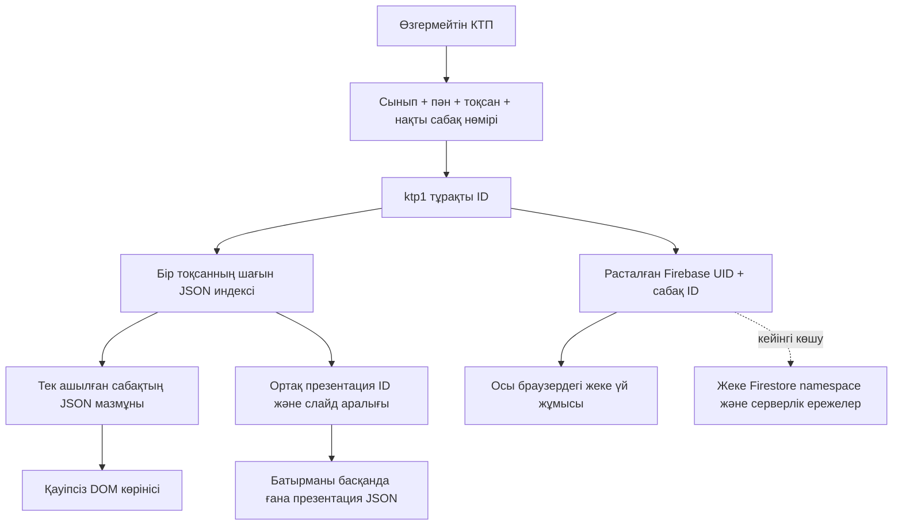

# Stage 8A — сабақ материалының архитектурасы

## Негізгі келісім

Негізгі тармақ: main `971f205650a18f141705b4e55607d7f578812d88`.
Жеке тармақ: `stage-8a-lesson-architecture`. Бұл кезең тек үлгі мен деректер келісімін енгізеді.

КТП — сабақ атауы, реті, нөмірі, бөлімі, пәні, сыныбы және оқу мақсаттарының жалғыз көзі.
Олар жаңа материалдың өңделетін өрістеріне көшірілмейді. Жаңа адаптер бастапқы
`LessonCatalog.rows()` нәтижесін оқиды. КТП файлдарының ешқайсысы өзгертілмейді.

## Тұрақты идентификатор

`ktp1:{grade}:{subject}:{quarter}:{number}`; төрт мәннің әрқайсысы `encodeURIComponent`
арқылы кодталады. Мысал: `ktp1:6:math:1:1`. Сабақ нөмірі бастапқы жол түрінде сақталады;
атаудан slug не массивтегі орыннан ID жасалмайды. Нұсқа префиксі болашақ миграцияны айқындайды.
КТП ресми түрде қайта нөмірленсе, үнсіз қайта байланыстыруға болмайды: жеке alias/migration
кестесі және мұғалімнің растауы керек. 1–11 сынып мәндері модельде жарамды, бірақ қазіргі
каталогта жоқ сыныпқа мазмұн бар деп көрсетілмейді.

## Модульдер және келісімдер

| Файл | Жауапкершілік |
|---|---|
| `lesson-materials/model.js` | version 1 модель, ID, қатаң өріс/тип/көлем тексеруі, бос сабақ |
| `lesson-materials/ktp.js` | Өзгермейтін КТП-ны бастапқы адаптер арқылы оқу |
| `lesson-materials/loader.js` | Шағын индекс, жеке JSON, bounded LRU, abort/timeout/retry |
| `lesson-materials/private.js` | UID + сабақ ID бойынша жергілікті жеке homework/notes, revision |
| `lesson-materials/legacy.js` | Жаңа тапсырмаларды бұрынғы конструктор оқитын өрістерге қауіпсіз проекциялау |
| `lesson-materials/demo.js` / `demo.css` | Бір демонстрациялық бет және презентация диалогы |
| `lesson-materials/entry.js` | Бұрынғы сабақ бетіне opt-in сілтемесін ғана қосу |

Индекс жолы: `index/{grade}/{subject}/q{quarter}.json`.
Жол жазбасы: `{lessonId, content: "content/.../1.json" | null, presentation: ref | null}`.
КТП атаулары мен оқу мақсаттары индекске де енгізілмейді.

Материалдың жоғарғы деңгейдегі өрістері:

| Өріс | Мағынасы |
|---|---|
| `schemaVersion`, `lessonId`, `reviewRequired` | Нұсқа, тұрақты байланыс, педагогикалық тексеру белгісі |
| `video` | `null` немесе provider/ID/title/publication метадеректері; медиа файлы емес |
| `theory`, `examples` | Мәтін/формула блоктары және шешілген мысалдар |
| `lessonPlan` | Бос массив немесе ұзақтығы дәл 45 минут болатын кезеңдер |
| `pairWork`, `groupWork` | Бос массивтер немесе тиісінше 3 кезекті, 4 топтық тапсырма |
| `individualWork` | A, B, C деңгейлеріндегі тапсырма массивтері |
| `games` | Қолданыстағы банк тақырыбының кілті және ұсынылатын ойын ID-лері |
| `assessment`, `homework`, `qmj` | Критерий/дескриптор/ұпай, үй жұмысы, мақсат/ресурс/алдыңғы білім |
| `presentation` | `null` немесе `{id, startSlide, endSlide}`; слайдтар көшірілмейді |

Тапсырмада `id, prompt, answer, solution, criteria, descriptors` бар. Әр тізімдегі ID бірегей.
Бос мазмұн — қалыпты күй: `empty(lessonId)` бос бөлімдерді қайтарады. Қате JSON, басқа
сабақтың ID-і немесе жарамсыз жол бөлек қате болып көрсетіліп, қайта жүктеу ұсынылады.

## Бір демонстрациялық сабақ

Жүйеге мұғалім ретінде кіріп ашу:
`lesson-material.html?class=6&subject=math&quarter=1&lesson=1`.

КТП тақырыбы: «Жай бөлшектерге амалдар қолдану». Оқу мақсаттары бастапқы КТП-дан дәл оқылады;
ондағы бос орындар мен кодтар түзетілмейді. Бір толық демо, 45 минуттық жоспар,
3 жұптық, 4 топтық, A/B/C тапсырмалары, критерийлер және үй жұмысы бар.
`reviewRequired: true`: мұғалім мазмұнды сабақта қолданар алдында тексеруі тиіс.
Видеосабақ ойдан толтырылмаған: `video: null`.

Келесі КТП сабағында толық материал жоқ (`content: null`), тек ортақ презентация байланысы бар.
Бұл екінші дайын сабақ емес. Барлық 64 КТП контекстінде дайын материал бар дегенді білдірмейді.

## Ортақ презентация

`fractions-review-v1` — 12 слайдтық теориялық блок. Бірінші сабақ 1–8 слайдтарды,
екінші сабақ 9–12 слайдтарды қолданады. Бірдей JSON қайталанып жүктелмейді.
Модель 10–15 слайдты тексереді, диапазон нақты слайд санынан аспайды.
Слайдтарда теория, формула, шешілген мысал және типтелген бөлшек сызбасы бар.
KaTeX пен оның CSS-і де презентация алғаш ашылғанда ғана жүктеледі.
Видеоны ойнату тек жарияланған метадерек және пайдаланушының жеке әрекеті арқылы басталады.

## Жүктеу және масштабтау

Бір ашылған сабаққа бір тоқсан индексі және бір материал JSON-ы жеткілікті.
Сурет, видео, презентация және ойын қозғалтқышы алдын ала жүктелмейді. `games-learning.js`
мен `ConstructorGameLinks` — тек қолданыстағы ойын метадеректерінің адаптері.
Бастапқы `link()` API `games.html` қайтарады; жаңа автоматты іске қосу параметрлері ойдан қосылмайды.
Барлық 20 сілтеме каталогты ашады; сынып/тақырып/ойын сол жерден таңдалады.
Конструктор сілтемесі нақты КТП контекстін ашады; демо мәтін автоматты көшірілмейді.

Жүктеуші тек өз каталогындағы same-origin JSON жолдарын қабылдайды; `..`, сыртқы URL,
query/hash және кодталған жол бөлгіштері қабылданбайды. Бір құжат шегі — 128 KiB,
LRU — 8 жазба және 512 KiB JSON payload. 10 секунд timeout, AbortSignal, MIME тексеруі,
ағынмен byte-limit, қате жауапты кэшке салмау бар. Бұл кэш көлемі JavaScript heap көлемімен
тең емес. HTTP `no-cache` сервердің валидаторларын қолдануға мүмкіндік береді; offline/PWA
қызметі қосылмаған. Құжат лимиті жетпесе, барлық материалды біріктірудің орнына кейін
бөлімдік resource reference енгізу керек.

Қазіргі `lesson.html` бұрынғы bulk `lesson-content*.js` жүктеуін сақтайды. Оның мазмұны
жоғалмайды, тек жаңа модульдік көрініске сілтеме қосылды. Бүкіл сайт lazy режимге көшірілді
деп жарияланбайды. 9–11 сыныптардың КТП метадеректері бастапқы upper-loader тәсілін пайдаланады;
бұл барлық сабақ материалын жүктеу емес.

## Келесі миграция

1. Өзгермейтін КТП snapshot/hash пен ескі contentKey → тұрақты ID сәйкестігін дайындау.
   7-сыныптың қысқа legacy кілттерін, қайталанған атауларды жеке тексеру.
2. Әр материалды жеке JSON-ға шығаруды read-only тексеру, нақты тапсырмалар мен оқу мақсаттарын
   мұғалімге салыстыру; бос бөлімдерге ойдан мәтін жазбау.
3. Тексерілген ортақ теорияны 10–15 слайдтық блоктарға бөліп, сабақтарға диапазонмен байланыстыру.
4. Серверлік қауіпсіздік қақпасынан кейін ғана бұлттық gateway және жариялау админ интерфейсін қосу.
5. Жергілікті `math-ai-lessons-v2:UID` кітапханасын экспорт/алдын ала көрініс/нақты келісім арқылы
   көшіру. Автоматты өшіру, үнсіз overwrite немесе браузер сақтауын серверлік деп көрсету болмайды.
6. Алдымен бір контекстке opt-in, регрессия және rollback тексеруі; кейін біртіндеп кеңейту.

Rollback: ескі сабақ сілтемесі мен кітапхана барлық кезеңде қалады. Жаңа бетке сілтемені алып тастау
жаңа JSON-дарды қолдануды тоқтатады; КТП/ойын/бұрынғы сабақ деректерін қалпына келтіру қажет емес.
